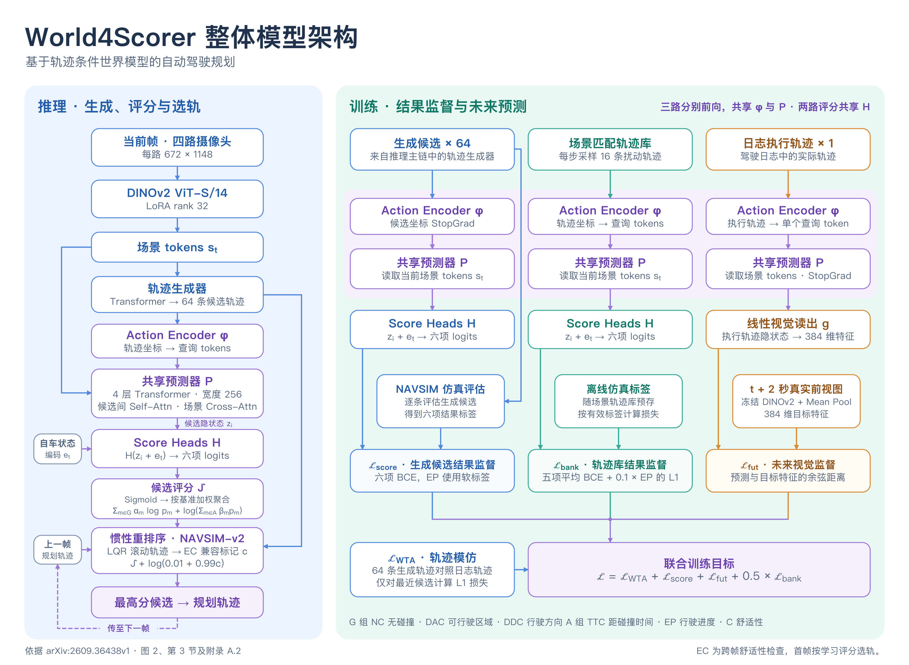

# Flowchart Painter Skill

`$flowchart` 是一个 Codex 技能，可以把 Mermaid 流程、ASCII 草图、文字描述或参考图整理成浅色圆角流程图。默认交付可编辑的 **SVG** 和从同一份 SVG 导出的 **2 倍分辨率 PNG**。SVG 里的文字、节点和连线都可以单独编辑。

## Demo

**World4Scorer 整体模型架构**。左侧是候选轨迹生成、评分与选轨的推理流程。右侧并列展示生成候选、轨迹库候选和日志执行轨迹三条训练分支，紫色区域标出共用模块。



[可编辑 SVG](assets/style-example.svg) · [高清 PNG](assets/style-example.png)

本图由 `$flowchart` 根据论文图 2 和第 3 节重绘。来源为 [Outcome-Grounded World Modeling for Autonomous Driving](https://arxiv.org/html/2609.36438v1#S3)。

## 配色与绘图风格

| 色系 | 底色 | 描边 / 标题 | 用途 |
| --- | --- | --- | --- |
| 浅蓝 | `#EDF4FF` | `#5088DC` / `#3479D6` | 第一组输入或分支 |
| 浅绿 | `#EAF8F3` | `#35A995` / `#159C88` | 第二组输入或分支 |
| 紫色 | `#FFFFFF` / `#F4EFFB` | `#9A77D5` / `#865AC9` | 共用模块采用白底，最终输出可用浅紫底 |
| 浅橙 | `#FFF4E6` | `#D58A32` / `#9B6228` | 可选分区、重点模块或辅助关系 |
| 灰蓝 | — | `#778497` | 节点内的说明文字 |

- **节点与留白**：白色画布配浅色分区和细描边圆角框。同组节点通常等宽，不同分区可分别定宽。根据文字行数和留白调整宽高，长标签可以分行。
- **连线**：优先用水平或竖直的直线，必要时用直角折线避让。同一输出可共用一段主干再分叉。多条线进入同一节点时，可以让末段平行、错开落点，减少多余转折。虚线用于明确标出的缓存、异步或辅助关系。
- **文字**：保留 `LayerNorm`、`Conv` 等英文术语和代码标识符，用简短中文补充用途、张量尺寸或输入输出。提供参考图时，也可以借鉴它的配色、布局和字体层级。

## 使用

将仓库中的 `SKILL.md`、`agents/`、`assets/` 和 `scripts/` 放入 Codex 的 `flowchart` 技能目录，例如 `~/.codex/skills/flowchart/`。在 Codex 中输入 `$flowchart`，再贴入流程或附上参考图。可以指定 `TB`（从上到下）或 `LR`（从左到右）。

把一段简单流程贴到 Codex，即可试用：

```text
$flowchart 把以下流程画成从左到右的架构图。

SensorBatch → SharedBEVEncoder → FusionBackbone
PNCBatch → VectorEncoder → FusionBackbone
FusionBackbone → PlannerDecoder → 轨迹输出

用浅蓝和浅绿区分两路输入，交付 SVG 和 PNG。
```

已有 SVG 也可以用仓库中的导出脚本生成 PNG。脚本会依次尝试已安装的 `rsvg-convert`、CairoSVG 或 macOS Quick Look。

```bash
python3 scripts/export_png.py assets/style-example.svg style-example.png --scale 2
```

[查看完整技能规则](SKILL.md)
